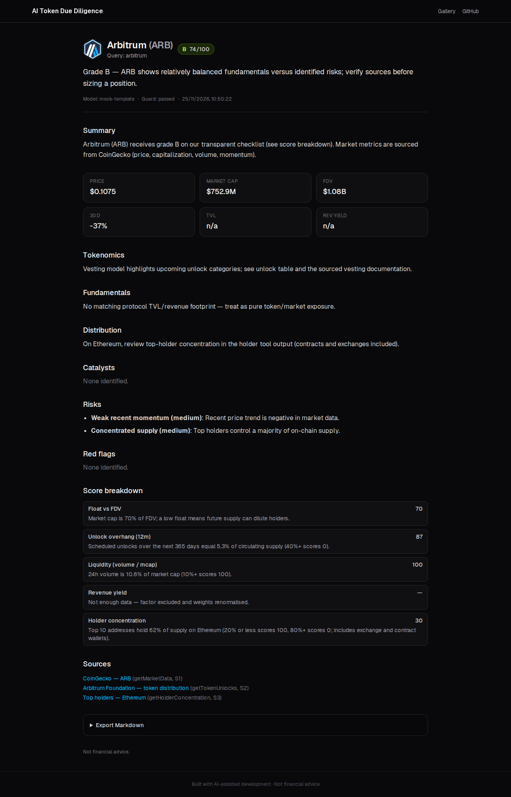
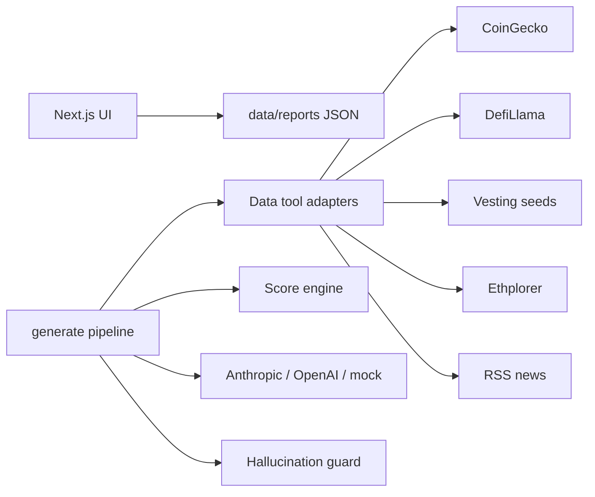

# AI Token Due Diligence Agent

**Ticker in → sourced due-diligence memo out.** Portfolio demo for on-chain research roles: composable data tools, transparent risk scoring, and LLM narrative with a numeric hallucination guard.



## Live demo

- **GitHub Pages (static):** https://osobennyj.github.io/warehouse-of-sites/projects/ai-token-due-diligence/
- **Source:** https://github.com/osobennyj/warehouse-of-sites/tree/master/projects/ai-token-due-diligence

The public demo uses **pre-generated reports** (mock LLM, no API key). Deploy with env vars for live Anthropic/OpenAI runs.

## Features

- **Research tools:** CoinGecko market data, DefiLlama TVL/fees/revenue, curated vesting schedules, Ethplorer top holders, RSS news mentions.
- **Agent workflow:** resolve token → parallel tools → deterministic score → LLM analysis → hallucination guard.
- **Gallery:** five sample reports (ARB, ENA, AAVE, UNI, PENDLE) committed under `data/reports/`.
- **Export:** Markdown memo per report (expand “Export Markdown” on the report page).

## Architecture



### FSD layout

| Layer | Responsibility |
| --- | --- |
| `app/` | Routes re-exporting views |
| `src/views/` | Page compositions |
| `src/widgets/` | Header, gallery |
| `src/features/` | Sample search form |
| `src/entities/report/` | Zod schemas, score, UI |
| `src/server/` | Agent, adapters, config |

## Stack

Next.js 16, TypeScript strict, Tailwind CSS 4, Vercel AI SDK 7, Zod 4, Vitest, Playwright, GitHub Actions.

## Local setup

```bash
pnpm install
cp .env.example .env.local   # optional for live LLM
pnpm generate:samples        # refresh gallery (CoinGecko rate limits apply)
pnpm dev
```

### Enable a real LLM

1. Set `LLM_PROVIDER=anthropic` (or `openai`).
2. Add `ANTHROPIC_API_KEY` or `OPENAI_API_KEY`.
3. Optional: `LLM_MODEL=claude-sonnet-4-6`.
4. Run `pnpm generate:samples` or wire the orchestrator to an API route on Vercel (not used in static GitHub Pages export).

Default CI/demo: `LLM_PROVIDER=mock`.

## Scripts

| Command | Purpose |
| --- | --- |
| `pnpm test` | Unit tests |
| `pnpm test:e2e` | Playwright smoke (needs static build + `start:static`) |
| `pnpm eval:hallucination` | Guard check on `data/reports/*.json` |
| `pnpm build:static` | GitHub Pages export |

## Built with AI

**Human:** product spec, FSD architecture, scoring methodology, vesting research, review, tests, deploy config.

**Agent:** implementation scaffolding, adapter code, UI polish, CI wiring.

## Disclaimer

Not financial advice. Third-party APIs can be incomplete or rate-limited; vesting seeds are curated approximations — always verify with official docs.