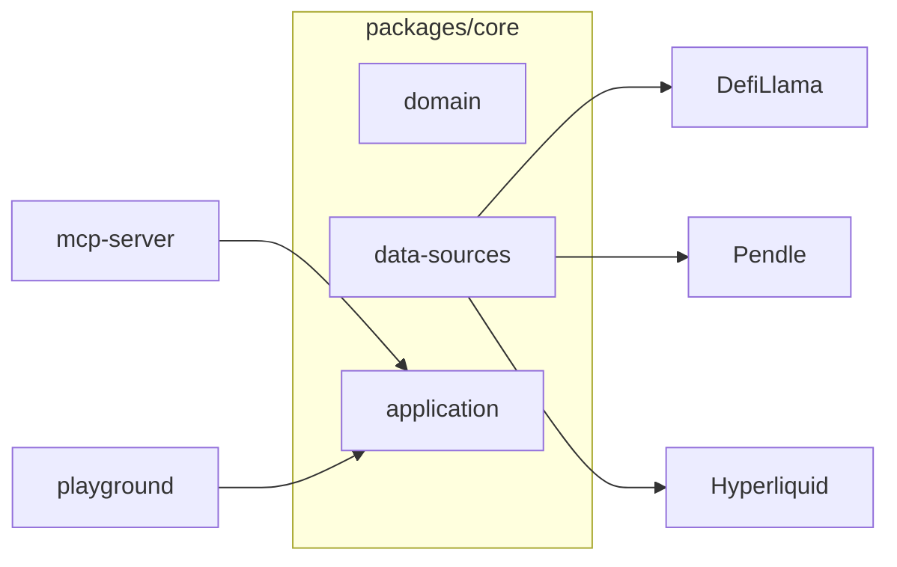

# DeFi Strategist MCP

**MCP server that gives AI agents analyst-grade DeFi strategy tools** — risk-adjusted yields, Pendle PT/YT, leverage loops, and Hyperliquid funding carry — plus a browser playground on the same core.

> Not financial advice. Read-only analytics on public APIs.

## Live demo

- **Playground (GitHub Pages):** https://osobennyj.github.io/warehouse-of-sites/defi-strategist/
- **Source:** https://github.com/osobennyj/warehouse-of-sites/tree/master/projects/defi-strategist-mcp

## Install (MCP clients)

### Claude Desktop / Cursor (stdio)

```json
{
  "mcpServers": {
    "defi-strategist": {
      "command": "npx",
      "args": ["-y", "defi-strategist-mcp@latest"]
    }
  }
}
```

### VS Code

Add the same `mcpServers` entry in your MCP config, or use the MCP Registry package `io.github.osobennyj/defi-strategist-mcp` once published.

### Optional HTTP (self-host)

```bash
node packages/mcp-server/dist/http.js
# POST JSON-RPC to http://127.0.0.1:8787 (Streamable HTTP, localhost only)
```

## Tools

| Tool | Purpose |
|------|---------|
| `find_yields` | Filter/rank DefiLlama pools with transparent 0–100 risk score |
| `analyze_pendle_market` | PT cheap/fair/rich vs underlying, YT breakeven |
| `simulate_loop` | Recursive borrow loops, HF, liquidation shock |
| `funding_carry` | Hyperliquid funding APR & delta-neutral carry |
| `compare_strategies` | Side-by-side 2–5 strategies |

Resources: `methodology://scoring`, `methodology://formulas`  
Prompts: `due_diligence_yield`, `stablecoin_yield_ladder`

## Architecture



- **domain:** pure math (no I/O)
- **data-sources:** adapter interfaces + live APIs + fixtures/snapshots
- **mcp-server:** tool/resource/prompt registration only
- **playground:** FSD-style `app` / `views` / `features` / `shared`

## Local development

```bash
cd projects/defi-strategist-mcp
pnpm install
pnpm run build
pnpm run test
pnpm --filter @defi-strategist/playground run dev
```

Env vars: see `.env.example`.

## Publish to npm & MCP Registry (owner steps)

1. Create npm account / org and generate **Automation** token → GitHub repo secret `NPM_TOKEN`.
2. From repo root, bump version in `packages/mcp-server/package.json` and `server.json`.
3. Tag and push: `git tag defi-strategist-v0.1.0 && git push origin defi-strategist-v0.1.0` — triggers `.github/workflows/defi-strategist-release.yml`.
4. Enable **GitHub Pages** (Settings → Pages → GitHub Actions) for the playground workflow.
5. Submit `server.json` to the [MCP Registry](https://modelcontextprotocol.io/registry) (`mcp publish` CLI) after npm package is live.
6. (Optional) Create public repo `osobennyj/defi-strategist-mcp` mirroring `packages/*` if you want a standalone git URL for the package metadata.

## Built with AI

| Role | Who |
|------|-----|
| Product spec, methodology, architecture, review | Bohdan Maistrenko |
| Implementation, tests, CI, docs | Cursor Cloud Agent |

## License

MIT