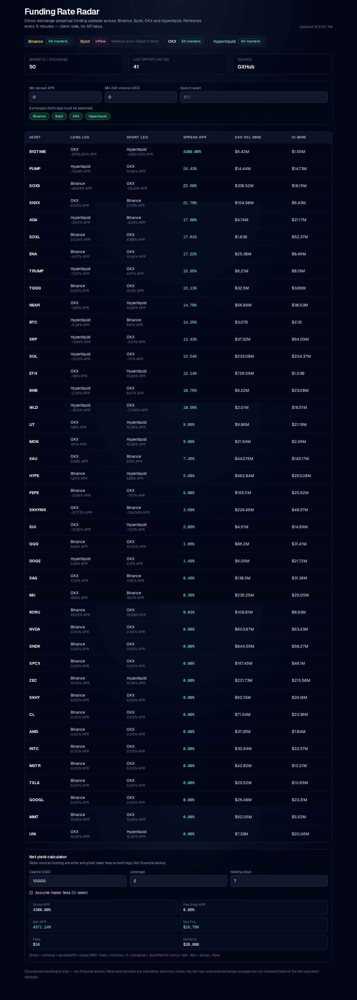
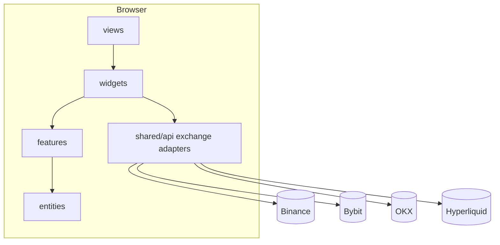

# Funding Rate Radar

> **Cross-exchange perpetual funding arbitrage scanner** — live spreads across Binance, Bybit, OKX and Hyperliquid with history, filters and a net-yield calculator. Not financial advice.



**Live demo:** https://osobennyj.github.io/warehouse-of-sites/ *(GitHub Pages — enable Pages on `warehouse-of-sites` if the link 404s)*

## Features

- **Collector (browser):** top 50 USDT perps per exchange, normalized asset tickers (`1000PEPE` → `PEPE`), funding interval → APR.
- **Opportunities table:** best long vs short venue, spread APR, liquidity proxies, filters.
- **Asset pages:** 7-day funding APR chart per exchange (SSG shells + client hydration).
- **Net yield calculator:** capital, leverage, holding period, taker/maker fees.
- **Resilience:** per-exchange status, stale badge, graceful degradation when a venue is down.

## Stack

Next.js 16 (static export) · TypeScript · TanStack Query · Tailwind 4 · Recharts · Zod · Vitest · Playwright · Steiger (FSD)

## Architecture



Layers follow **Feature-Sliced Design** under `src/`. Exchange integrations implement `ExchangeFundingSource` (dependency inversion): one adapter file per venue.

## Local setup

```bash
pnpm install
cp .env.example .env.local
pnpm dev
```

| Variable | Purpose |
|----------|---------|
| `NEXT_PUBLIC_BASE_PATH` | Set to `/warehouse-of-sites` for monorepo GitHub Pages |
| `NEXT_PUBLIC_*_API_URL` | Override exchange endpoints (defaults are public REST URLs) |

## Tests & quality

```bash
pnpm run lint && pnpm run typecheck && pnpm run fsd:lint
pnpm run test:coverage    # domain + adapters >= ~78% lines
pnpm run build && pnpm run test:e2e
pnpm run fixtures:record  # refresh adapter JSON fixtures (optional)
```

## Deploy (GitHub Pages)

Workflow: `.github/workflows/funding-rate-radar-pages.yml` (monorepo root). Builds `projects/funding-rate-radar` with `NEXT_PUBLIC_BASE_PATH=/warehouse-of-sites` and uploads `out/` to Pages.

Standalone repo: leave `NEXT_PUBLIC_BASE_PATH` empty and publish `out/` to any static host.

## Built with AI

- **Human:** product scope, FSD layout, exchange normalization rules, risk copy, review & acceptance.
- **Agent:** adapters, UI, tests, CI, fixtures, README.

## Disclaimer

Educational tool only. Funding spreads are indicative; execution, basis, borrow costs and outages are not fully modeled.