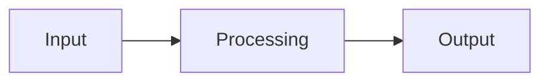

---
# Copy to content/projects/<slug>.md (kebab-case). Files starting with "_" are ignored.
# The frontmatter is validated at build time (src/entities/project/model/schema.ts).
title: My Project
tagline: One line — the problem and how this project solves it (10–140 chars).
description: Meta description for search engines and link previews (30–220 chars).
status: in-progress # live | beta | in-progress
tags: [Research] # 1–3 of: Research, Trading, Bots, AI, DeFi
stack: [TypeScript, Next.js] # 2–6 items
metric:
  value: 4 venues # short headline number (max 24 chars)
  label: what the number means
links:
  live: https://example.com # optional
  github: https://github.com/osobennyj/my-project # optional
# cover: # optional; without it a generated cover is used
#   src: /projects/my-project/cover.png # file in public/
#   alt: Dashboard showing ...
accent: teal # teal | violet | amber | sky | rose | lime (generated cover colour)
featured: true # show on the home page
order: 10 # lower = earlier
date: 2026-11-25
---

## Problem

## Solution

## Architecture

## Key decisions & trade-offs

## Results

## Next steps
