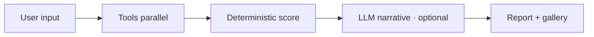

## Problem

Token diligence spans half a dozen tabs; naive LLM reports invent numbers. I wanted an auditable pipeline where every figure ties to a tool result.

## Solution

- **Parallel data tools** — CoinGecko, DefiLlama, vesting, holder concentration, news; Zod on inputs and outputs.
- **Composable agent** — deterministic risk score, then Anthropic/OpenAI (or mock) for narrative only.
- **Gallery** — five live-data sample reports (ARB, ENA, AAVE, UNI, PENDLE) with offline eval script that checks numeric fields match tool output.
- **Static export** — works on GitHub Pages without API keys; plug in `ANTHROPIC_API_KEY` locally for real runs.

FSD layout, Vitest coverage, Playwright smoke, hallucination eval in CI.

## Architecture

## Results

- End-to-end LLM product signal: adapters, structured output, guardrails, eval — not a chat wrapper.
- Crypto fit: unlock pressure, TVL/revenue, holder concentration in one flow.

## Next steps

Rate-limited public demo with serverless host, reuse DeFi Strategist analytics as extra tools.