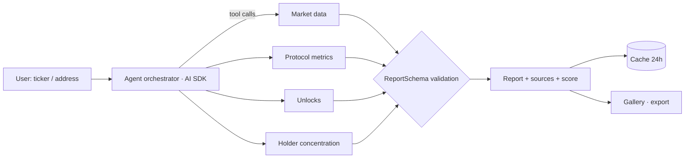

## Problem

Evaluating a token properly means collecting tokenomics, FDV vs market cap, unlock schedules, protocol revenue and
holder concentration from half a dozen sources — then writing it up. LLMs can speed that up, but they hallucinate
numbers, which makes a naive "ask ChatGPT" report useless for investment work.

## Solution

Enter a ticker, CoinGecko id or contract address. An agent calls typed data tools and produces a report validated
against a strict schema:

- **Tools** — market data (CoinGecko), protocol metrics (DefiLlama TVL, fees, revenue), unlocks, top-holder
  concentration and recent news; each with Zod input and output schemas.
- **Structured report** — summary, tokenomics, fundamentals, on-chain distribution, catalysts, red flags and a
  0–100 score with its breakdown.
- **Hallucination guard** — numeric fields can only be filled from tool outputs, and every claim links to its source.
- **Shareable output** — streaming progress, Markdown and PDF export, cached reports and a public gallery.

## Architecture

## Key decisions & trade-offs

- **Schema-first output.** The model fills a Zod schema rather than free text, so reports are comparable and
  machine-checkable.
- **Provider abstraction.** OpenAI or Anthropic via configuration; the agent is tested with a mocked provider that
  returns scripted tool calls.
- **Cost controls.** Per-IP rate limits, a daily budget cap and cached reports keep a public demo affordable.

## Status

In active development. Example reports and the live demo will be linked here on release.

## Next steps

An evaluation script over ten known tokens that checks every number in the report against tool outputs, and reuse of
the DeFi Strategist analytics as additional tools.
