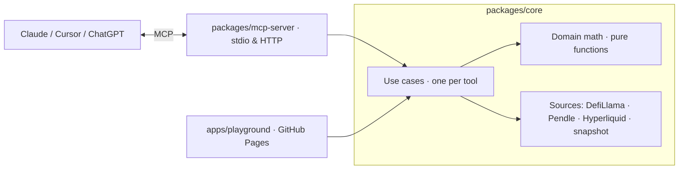

## Problem

Asking an AI agent "is this PT cheap?" or "what happens to my 3x stETH loop if ETH drops 20%?" usually produces
confident nonsense. Raw-data MCP servers already exist for prices and TVL, but the hard part is the **methodology**:
implied vs underlying APY, health factors, reward-vs-base yield quality. That knowledge lives in a researcher's head —
I wanted to package mine as tools an agent can call.

## Solution

An MCP server that plugs into Claude Desktop, Cursor, ChatGPT or VS Code and exposes derived analytics:

| Tool                    | What the agent gets                                                                  |
| ----------------------- | ------------------------------------------------------------------------------------ |
| `find_yields`           | DefiLlama pools ranked by a transparent risk-adjusted score with its breakdown       |
| `analyze_pendle_market` | Implied vs underlying APY, PT fixed yield, YT breakeven and a cheap/fair/rich verdict |
| `simulate_loop`         | Leverage, net APY, health factor and the price drop to liquidation                   |
| `funding_carry`         | Hyperliquid funding, annualized, and delta-neutral carry after fees                  |
| `compare_strategies`    | Side-by-side net APY, risk score and key risks of 2–5 strategies                     |

Methodology is exposed as MCP resources, so the agent can read _how_ a number was computed. The same core powers a
static web playground — every tool runs in the browser, no keys needed.

## Architecture

## Key decisions & trade-offs

- **Derived analytics, not another data proxy.** The value is the encoded expertise, which is hard to copy without
  domain knowledge.
- **Pure core, thin presentation.** Formulas have hand-checked unit tests (negative funding, borrow APY above supply
  APY, LTV at the liquidation threshold); MCP registration is a thin adapter, so adding a tool touches one use case
  and one registration file.
- **Keyless, read-only.** Only public APIs, no wallets and no transactions — safe to install in 30 seconds.

## Status

In active development. The npm package, playground link and recorded agent conversations will be added on release.

## Next steps

More protocols (Aave, Morpho, Ethena), a stablecoin yield-ladder prompt and an evaluation suite that checks every
number in the agent's answer against tool output.
