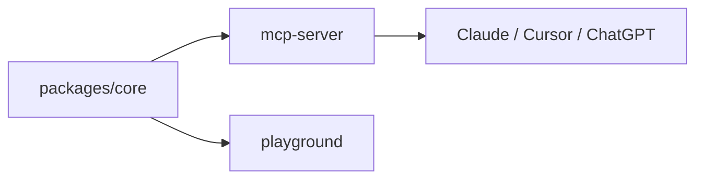

## Problem

Raw-data MCP servers already exist for prices and TVL. The hard part is methodology: implied vs underlying APY, health factors, reward-vs-base yield quality, knowledge that lives in a researcher's head.

## Solution

**MCP tools** (Zod input/output, LLM-oriented descriptions):

| Tool | Output |
|------|--------|
| `find_yields` | DefiLlama pools ranked by transparent risk-adjusted score |
| `analyze_pendle_market` | PT/YT verdict with formulas |
| `simulate_loop` | Leverage, HF, liquidation price, net APY |
| `funding_carry` | Hyperliquid funding annualized + fee-aware carry |
| `compare_strategies` | Side-by-side net APR, risk score, key risks |

Resources `methodology://scoring` and `methodology://formulas`, prompt templates for due diligence and stablecoin ladders.

**Monorepo:** `packages/core` (pure domain → adapters → use cases), `packages/mcp-server`, `apps/playground`. MCP SDK v2 in-memory integration tests + Playwright smoke.

## Architecture

## Results

- CI: typecheck, unit + MCP integration, daily snapshot workflow stub, npm release workflow with `NPM_TOKEN`.
- Strong signal for analyst and builder roles: domain expertise packaged as installable tools.

## Next steps

More chains on Pendle, richer carry fees, publish to npm registry after owner adds `NPM_TOKEN`.