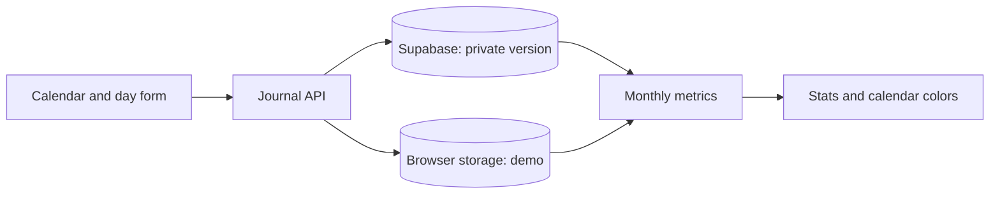

## Problem

Most trading journals track profit and loss. A losing trade that followed the plan is fine. A winning trade that broke the plan is a warning sign. I wanted a journal that records that difference.

## What it does

Each day in a monthly calendar gets one color:

- **Green:** every trade followed the plan, or it was a deliberate no-trade day.
- **Red:** at least one off-plan trade, tagged FOMO, revenge, overtrade, impulse or other.
- **Gray:** nothing logged.

Open a day to log trades (result and RR), setups you skipped and what they would have done, mood, notes and screenshots. Monthly stats compare by-plan and off-plan trades: win rate, average RR, green streak, best and worst asset.

## Decisions

- **Color ignores profit and loss.** RR is recorded per trade, but the color only answers whether the plan was followed.
- **Skipped trades are tracked.** "What would have happened" is the question that comes up after every skipped setup, so the journal stores the answer.
- **Demo mode, not a read-only copy.** You can add and delete trades and watch the stats change.

## Architecture

The same screens run on two backends. The private version signs in and stores data in Supabase. The public demo uses browser storage, so no login is needed and nothing leaves your device.

## Limits

- The demo data is invented and generated per month. It is not real trading history.
- No automated tests.
- Not investment advice.

## Next steps

Weekly review, CSV export, breakdown of off-plan trades by tag.
