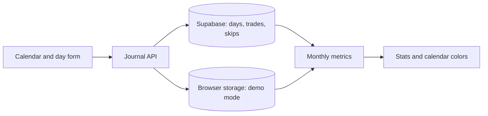

## Problem

Most trading journals track profit and loss. The thing that actually moves results is discipline: whether you took only the trades your plan allows. A losing trade that followed the plan is fine. A winning trade that broke it is a warning sign.

## Solution

A monthly calendar where each day gets one color:

- **Green:** every trade followed the plan, or it was a deliberate no-trade day.
- **Red:** at least one off-plan trade (tagged FOMO, revenge, overtrade or impulse).
- **Gray:** nothing logged.

Open a day to log trades with result and RR, setups you skipped and what they would have done, mood, notes and screenshots. The monthly stats compare by-plan and off-plan trades: win rate, average RR, current green streak, best and worst asset.

I built it for my own trading, so the feature set follows real needs: skipped trades are tracked because "what would have happened" is the question I kept asking.

## Architecture

The same screens run on two backends. The private version signs in and stores data in Supabase. The public demo swaps in a local backend, so no login is needed and nothing leaves your browser.

## Key decisions & trade-offs

- **Demo mode instead of a read-only copy:** you can add and delete trades to see the stats react.
- **Sample data is invented** and generated per month, so the calendar is never empty. It is not real trading history.
- **No profit and loss numbers.** RR is recorded per trade, but the calendar color depends only on discipline.

## Results

- Used daily for my own trading journal.
- Static demo with no server and no account.

## Next steps

Weekly review view, export to CSV, and tag-based breakdown of off-plan trades.
