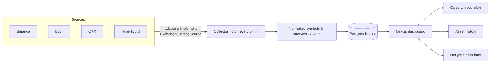

## Problem

Funding-rate arbitrage — long the perp where funding is cheap, short where it is expensive — is one of the few
market-neutral yields in crypto. In practice it is tedious to find: every venue publishes rates in its own symbol
format, on its own interval (1h, 4h or 8h), and a spread that looks juicy often disappears once you account for
fees and thin liquidity on one leg. I ran this strategy with Python scripts; I wanted a tool I could open instead.

## Solution

A dashboard that collects funding data from four public exchange APIs every five minutes, normalizes symbols and
intervals to a common **annualized APR**, and ranks cross-venue opportunities:

- **Opportunities table** — best long venue vs best short venue per asset, spread APR and the weaker leg's liquidity
  (open interest and 24h volume), with filters for minimum spread, volume and venues.
- **Asset page** — seven days of funding history per exchange and the spread over time.
- **Net yield calculator** — capital, leverage, holding period and per-venue fees in; net APR and PnL out, with
  every formula shown in the UI.
- **Freshness per exchange** — if one API fails, the rest keep working and the stale venue is clearly flagged.

## Architecture

## Key decisions & trade-offs

- **One adapter per exchange behind a common interface.** Adding a venue means one new file; the collector and the
  math never change.
- **APR math as pure, unit-tested functions.** Normalization and fee handling are where the money is lost, so they
  are tested in isolation, including negative funding and zero-volume edge cases.
- **Polling, not websockets.** Funding updates at most hourly, so a five-minute cron is simpler and cheaper with no
  loss of signal.

## Status

In active development. The live demo, screenshots and measured numbers will appear here as soon as it ships.

## Next steps

Historical backtest of the delta-neutral strategy, alerts when a spread crosses a threshold, and more venues.
