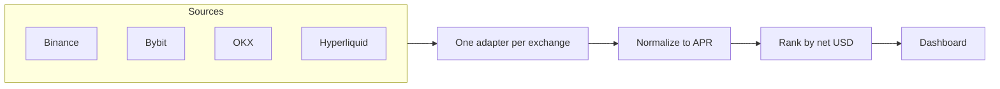

## Problem

Funding-rate arbitrage means going long a perpetual on the exchange that pays less and short on the one that pays more. Each exchange uses different symbols, funding intervals (1h, 4h, 8h) and fees, so comparing them by hand is slow and error-prone. A spread that looks large often disappears after fees or sits on a market with little liquidity.

## What it does

- Reads public REST APIs from Binance, Bybit, OKX and Hyperliquid (top 50 markets each) every 5 minutes. No API keys.
- Converts every rate to an annualized APR so the venues are comparable.
- Ranks assets by net USD for the next funding window, after taker fees on both legs, at the position size you enter.
- Shows 7 days of funding history per asset, and a net yield calculator with the formulas visible.
- If one exchange fails, the others keep working and the failed one is flagged.

## Decisions

- **Rank by net USD, not APR.** The highest APRs on the page are usually thin markets. Net USD at a fixed size is the number that decides whether the trade is worth opening.
- **Taker fees on both legs, entry and exit.** The conservative case, so the result is not flattered.
- **Everything runs in the browser.** No backend to maintain. The cost is that history is limited to what the exchange APIs return.

## Architecture

## Tests

50 unit tests (Vitest) cover APR conversion, spread ranking, the calculator and the parsing of each exchange response. Responses are recorded as fixtures, so CI does not call the live APIs. A Playwright smoke test and GitHub Actions run on every push.
