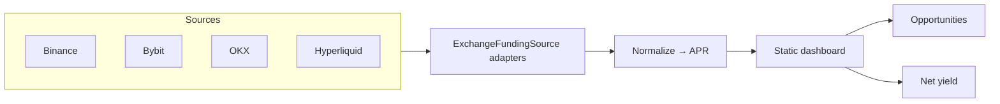

## Problem

Funding-rate arbitrage is tedious to operationalize: every exchange uses different symbols, funding intervals (1h / 4h / 8h) and fee schedules. A spread that looks rich often disappears once you normalize APR and account for thin liquidity on one leg.

## Solution

A static client-side dashboard that polls public REST APIs, normalizes funding to a common **annualized APR**, and ranks delta-neutral opportunities:

- **Opportunities table:** best long vs short venue per asset, spread APR, min OI/volume across legs, filters by spread, volume and exchange.
- **Per-asset history:** seven days of funding per venue and spread over time.
- **Net yield calculator:** capital, leverage, holding period and taker/maker fees, with net APR and PnL formulas visible in the UI.
- **Graceful degradation:** if one exchange fails, the others keep working with a clear stale flag.

Four adapters implement a shared `ExchangeFundingSource` interface; domain math and API parsing are covered by recorded fixtures and Vitest.

## Architecture

## Results

- **~80%** line coverage on domain and adapter layers with recorded JSON fixtures (no live network in CI).
- Steiger-enforced FSD layout, Playwright smoke, GitHub Actions CI.
- Shipped in monorepo PR, ready to extract to a dedicated repo when permissions allow.

## Next steps

Postgres history via cron on a serverful host, spread alerts, more venues.