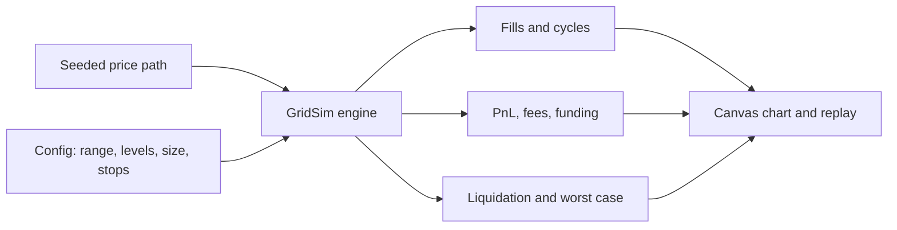

## Problem

A grid strategy looks simple on paper, but its results depend on details that are easy to miss: how fees and funding accumulate, how far the price can travel before the position becomes dangerous, and what a stop actually closes. A chart of the grid rarely shows these.

## Solution

A browser simulator that places one resting limit order per level and replays a synthetic price path:

- **Fills and cycles:** a buy fill places a sell one level up, and a sell fill places a buy one level down. Each completed cycle books its gain.
- **Accounting:** realized and unrealized PnL, maker and taker fees, and funding paid or received, all shown side by side.
- **Risk:** a liquidation price estimate, stop-loss levels that close the position, and a worst-case loss for a one-way move out of the range.
- **Replay:** a slider steps through the run so you can see exactly when each fill happened.

The engine is pure logic with no exchange code. It has 10 tests, including a reconciliation check on a random path.

## Architecture

## Results

- Engine tests cover round-trip cycle accounting, funding sign, stop and liquidation triggers, worst-case loss and reconciliation.
- Runs entirely in the browser with no build step and no runtime dependencies.

## Limits

- The simulator uses synthetic prices, and fees and funding are fixed demo values.
- Money is handled as JavaScript numbers, which is fine for a demo and not for real order sizing.
- No exchange adapter is included. Connecting one would be a separate project.

## Next steps

A real exchange adapter behind the same engine interface, tested on recorded data before any live use.
