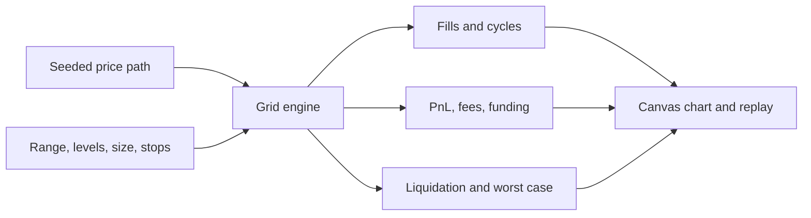

## Problem

A grid strategy looks simple on paper. Its result depends on details that a price chart does not show: how fees and funding accumulate, how far price can travel before the position is in danger, and what a stop actually closes.

## What it does

It places one resting limit order per level and replays a synthetic price path:

- A buy fill places a sell one level up, a sell fill places a buy one level down. Each completed cycle books its gain.
- Realized and unrealized PnL, maker and taker fees, and funding are shown side by side.
- It estimates the liquidation price and the worst-case loss if price leaves the range and never returns.
- Stop-loss levels close the position and halt the grid.
- A replay slider steps through the run fill by fill.

## Decisions

- **Worst case is shown by default.** Grid results look good while price stays in range. The one-way-move loss is what the setup can actually cost, so it sits next to the PnL.
- **Synthetic prices from a seed.** The same seed gives the same run, so a result can be reproduced and checked.
- **The engine has no UI or exchange code.** It can be tested on its own.

## Architecture

## Tests

10 tests (node:test) cover cycle accounting, funding sign, stop and liquidation triggers, worst-case loss, seed determinism and a reconciliation check on a random path.

## Stack

The demo is plain JavaScript in the browser. My own grid bot scripts are written in Python.
