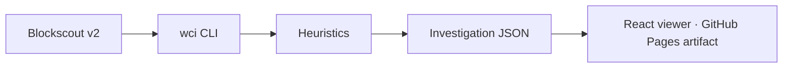

## Problem

On-chain hiring managers want reproducible attribution, not black-box labels. I needed to show I understand wallet clustering methodology, not only that I used Arkham.

## Solution

- **`wci` CLI:** BFS expansion over native and ERC-20 transfers with guards (min value, max counterparties, CEX/bridge stop-list), disk cache, polite rate limits.
- **Four heuristics:** common funder, CEX deposit reuse, synchronized activity, sweep-to-collector; each returns evidence (addresses, confidence, tx hashes).
- **Union-find clustering** with transparent weighted scores surfaced in the UI.
- **Static viewer:** Cytoscape graph, filters, evidence panel, cluster table, optional live +1 hop via Blockscout CORS.
- **Three committed investigations** on public, documented fund flows (e.g. known exploit hops).

Versioned investigation JSON (Pydantic) + Markdown reports. Ethics copy in UI: probabilistic attribution, not an accusation.

## Architecture

## Results

- Full CI: ruff/mypy/pytest on collector, eslint/tsc/vitest/playwright on viewer.
- Demonstrates analyst-grade workflow hiring teams ask for in 2026 job posts.

## Next steps

More chains, timing heuristics, bridge-aware tracing.