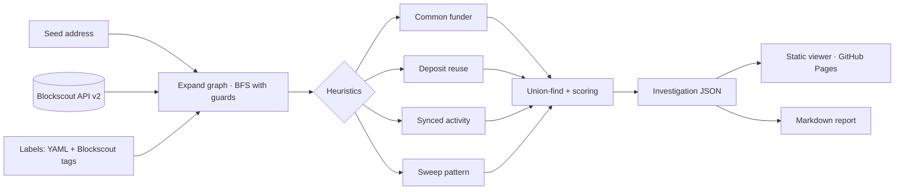

## Problem

Attribution is the core skill of on-chain research: which wallets belong to the same entity, who funded them and
where the money went. Commercial platforms answer this with black-box labels. At Arkham I saw how much users rely on
that — and how rarely they can see _why_ two wallets are linked. I wanted to reproduce the methodology transparently.

## Solution

A CLI that expands a seed EVM address into a funding graph and a static viewer that turns the result into a public,
reviewable investigation:

- **Bounded graph expansion** — breadth-first search over native and ERC-20 transfers (depth 2 by default) with
  guards: minimum value, max counterparties per node and a stop-list of CEX hot wallets, bridges and routers.
- **Explainable heuristics** — common funder, CEX deposit-address reuse, synchronized activity and sweep-to-collector.
  Each rule returns evidence: addresses, confidence and the transaction hashes that prove it.
- **Transparent clustering** — evidence is merged with union-find; cluster confidence is a weighted score whose
  weights are visible in the UI.
- **Interactive viewer** — graph coloured by cluster and sized by volume, filters by value, heuristic and time,
  an evidence panel with explorer links and a downloadable Markdown report.

All data comes from the public, keyless Blockscout API (Ethereum, Base, Arbitrum, Optimism), so anyone can
re-run an investigation.

## Architecture

## Key decisions & trade-offs

- **Heuristics as independent pure functions.** A new rule is a new file; each one is tested on hand-built positive
  and negative graphs, and its false-positive risks are documented.
- **Evidence over verdicts.** Attribution is probabilistic, so the output is "linked because of these transactions",
  never an accusation. Investigations cover only publicly documented cases.
- **Static by default.** Committed investigation files make the demo fast, free and reproducible; an optional live
  mode expands one hop directly from the browser.

## Status

In active development. Sample investigations, the live viewer and a graph demo will appear here once published.

## Next steps

More chains, bridge-aware tracing and timing-based heuristics.
