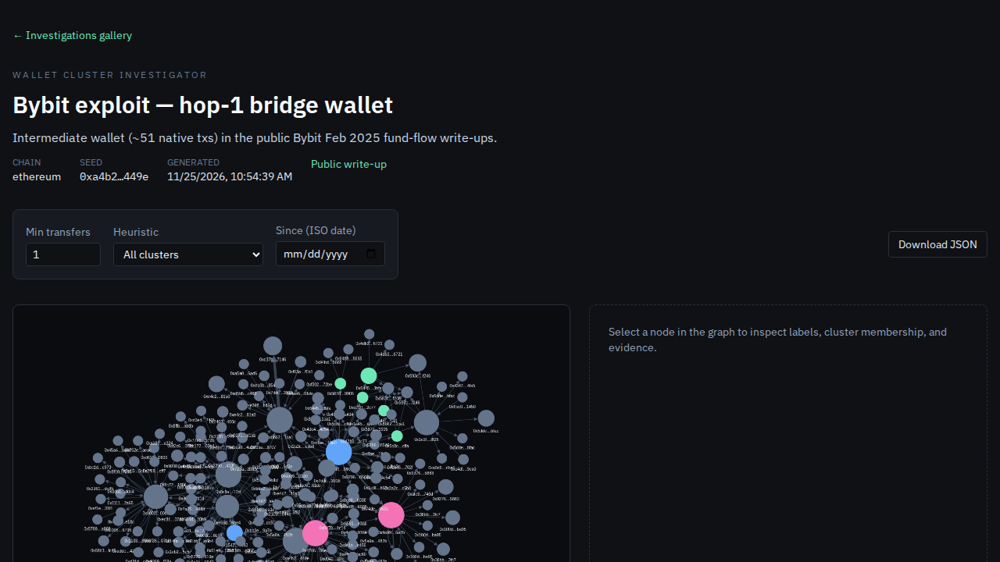
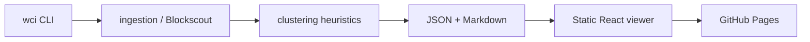

# Wallet Cluster Investigator

**Expand a seed EVM address into a funding graph and explainable wallet clusters — a mini Arkham-style investigator for analyst portfolios.**



- **Live demo (GitHub Pages):** https://osobennyj.github.io/warehouse-of-sites/
- **Source:** `projects/wallet-cluster-investigator` in [osobennyj/warehouse-of-sites](https://github.com/osobennyj/warehouse-of-sites)

> Attribution is **probabilistic**. Public on-chain data only — not an accusation.

## Features

| Area | Capability |
|---|---|
| CLI | BFS funding graph (native + ERC-20), disk cache, rate limits, label stop-list |
| Clustering | 4 explainable heuristics + union-find + weighted scores |
| Output | Versioned investigation JSON (v1) + Markdown report |
| Viewer | Cytoscape graph, filters, evidence panel, live Blockscout expand |

## Architecture



### Heuristics (false-positive risks)

1. **common_funder** — shared first native funder (sybil farms, exchange batch funding).
2. **cex_deposit_reuse** — shared intermediate → CEX hot wallet (hot-wallet collisions possible).
3. **synchronized_activity** — aligned first-seen + contract touch pattern (MEV bots, airdrop waves).
4. **sweep_pattern** — many wallets → one collector (treasury sweeps vs unrelated dust).

## Stack

- **Collector:** Python 3.12, httpx, Pydantic v2, networkx, typer, pytest + respx
- **Web:** Vite, React 19, TypeScript strict, Tailwind, Cytoscape.js, Zod (FSD layout under `web/src`)
- **Data:** Blockscout API v2 (no API key)

## Local setup

### Collector

```bash
cd collector
pip install -e ".[dev]"
wci investigate 0xYOUR_ADDRESS --chain ethereum --depth 2 --max-nodes 80 --since 2024-01-01 --min-value-eth 0.01 -o ../investigations/my-case.json
wci export-json-schema -o ../web/public/investigation.schema.json
pytest -q
```

### Viewer

```bash
cp investigations/*.json web/public/investigations/
cd web
pnpm install
pnpm dev
```

Env vars: none required (optional `VITE_BASE_PATH` for GitHub Pages base, default `/warehouse-of-sites/` in CI).

## Tests

- `collector`: `pytest`, `ruff`, `mypy --strict`
- `web`: `vitest`, Playwright smoke (`pnpm run test:e2e`)

## Deploy

Push to `master` with GitHub Pages enabled (Actions source). Workflow: `.github/workflows/wallet-cluster-investigator.yml`.

## Sample investigations

Three committed JSON cases around the public **Bybit Feb 2025** fund-flow reporting (Blockscout tags + on-chain hops).

## Built with AI

| Human (Bohdan) | AI agent |
|---|---|
| Requirements, architecture, heuristic review, ethics framing | Collector + web implementation, tests, CI, sample runs |
| Validated Blockscout assumptions, chose public cases | Pagination/typing fixes after live API feedback |

## Ethics

Public chain data only. Probabilistic clustering for research — always corroborate with independent evidence before any external attribution.